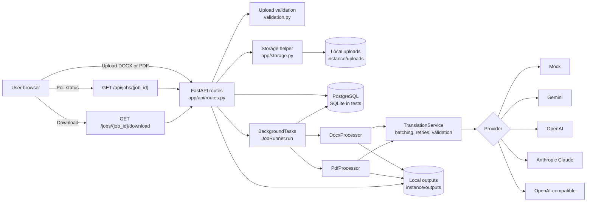
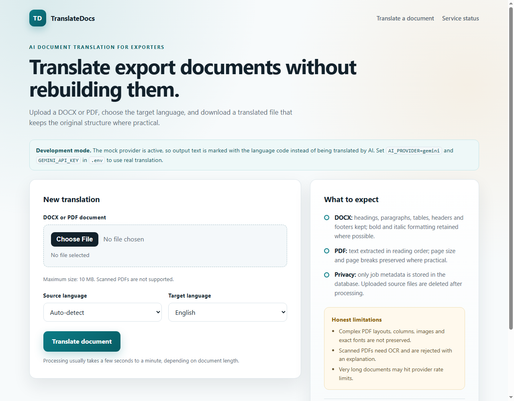
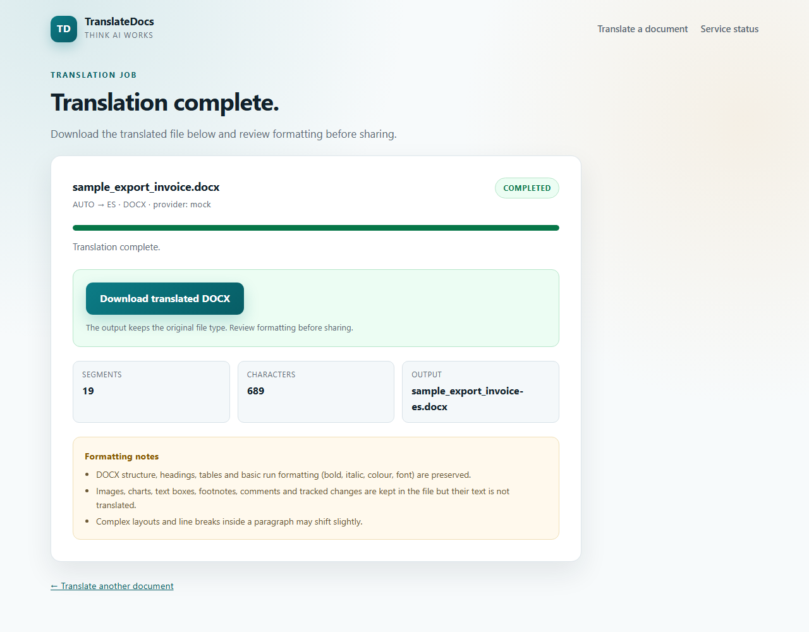
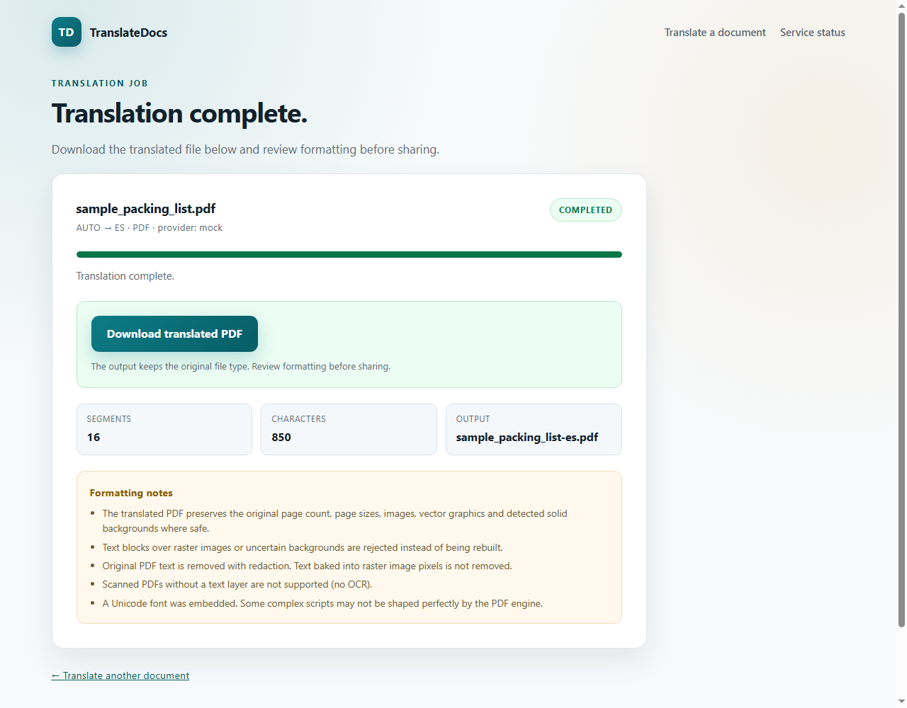

# TranslateDocs

TranslateDocs is a Python and FastAPI application for translating DOCX and PDF export documents while preserving as much readable structure as practical. It is intended for exporters, small trade teams, and evaluation users who need a simple upload-to-download translation workflow rather than a full document-management system.

The application supports a deterministic mock provider for development plus three interchangeable real LLM providers: Google Gemini, OpenAI, and Anthropic Claude. A separate generic OpenAI-compatible adapter remains available for other endpoints. The current default is mock mode; it does not produce real translations.

> **Project status:** Early-stage evaluation project. The mock DOCX/PDF workflow is covered by automated tests and was verified against the configured Neon PostgreSQL database. The Gemini, OpenAI, and Anthropic adapters are covered by mocked SDK tests only; none of them has been live-tested with real credentials in this repository. The application is **not ready for public deployment** because authentication, rate limiting, output retention, and other abuse controls are not implemented.

## Features

- Upload DOCX and PDF documents through a browser form.
- Select a source language or auto-detect, and choose a target language.
- Validate file extension, size, structure, and password protection; reject scanned PDFs without a text layer during processing.
- Process documents through FastAPI background tasks.
- Poll job status and download completed output from the same job page.
- Translate DOCX paragraphs, tables, headers, and footers with approximate run-formatting preservation.
- Rebuild PDFs as readable text PDFs while preserving page sizes where practical.
- Switch between mock, Gemini, OpenAI, Anthropic Claude, and OpenAI-compatible endpoints by changing environment configuration only.
- Batch translation requests with bounded retries and response validation.
- Generate synthetic DOCX and PDF samples for testing and demos.
- Run automated tests with isolated temporary SQLite databases.
- Enforce Alembic schema readiness at application startup.

## Technology stack

| Layer | Technology |
|---|---|
| Language | Python. The recorded local test run used Python 3.13.5; other versions were not verified. |
| Web application | FastAPI, Starlette, Jinja2, Uvicorn |
| Configuration | Pydantic Settings and `.env` |
| Database | SQLAlchemy 2.x, Alembic, PostgreSQL through `psycopg` |
| Test database | SQLite in isolated temporary directories |
| DOCX processing | `python-docx` |
| PDF processing | PyMuPDF (`pymupdf` / `fitz`) |
| AI providers | Mock, Google Gemini through `google-genai`, OpenAI through `openai`, Anthropic Claude through `anthropic`, and generic OpenAI-compatible HTTP endpoints through `httpx` |
| Testing | `pytest` and FastAPI `TestClient` |
| Frontend | Server-rendered HTML, CSS, and vanilla JavaScript polling |

PostgreSQL is the intended application database. SQLite is used by the test suite and can be used for local smoke testing, but SQLite test results do not prove PostgreSQL compatibility.

## Architecture



A more detailed explanation is available in [docs/architecture.md](docs/architecture.md).

## Repository layout

```text
app/
  api/routes.py                 HTTP routes and upload handling
  config.py                     Environment-backed settings
  database.py                   SQLAlchemy engine, sessions, schema gate
  models.py                     Job model and status values
  schemas.py                    API response models
  storage.py                    Local upload/output storage
  languages.py                  Supported languages and RTL set
  errors.py                     Safe application error types
  services/jobs.py              Background job execution
  services/documents/           DOCX, PDF, validation, and font logic
  services/translation/         Provider abstraction and implementations
  templates/                    Jinja2 pages
  static/                       CSS
alembic/
  versions/0001_create_jobs.py  Initial jobs table migration
tests/                          Pytest suite
scripts/make_samples.py         Synthetic sample generator
samples/                        Generated synthetic DOCX and PDF samples
docs/                           Architecture documentation
screenshots/                    Genuine local application screenshots
```

## Prerequisites

- Python and `pip`.
- A PostgreSQL database for the intended application configuration.
- No API key is required for mock mode.
- A real provider requires the matching API key and a model available to that account.
- A free or local OpenAI-compatible endpoint can be used through the separate `openai_compatible` adapter.
- No dependency installation or database migration is performed automatically by the application.

## Installation

From the repository root on Windows PowerShell:

```powershell
python -m venv .venv
.\.venv\Scripts\Activate.ps1
python -m pip install -r requirements.txt
```

If PowerShell activation is restricted, call the virtual-environment interpreter directly:

```powershell
.\.venv\Scripts\python.exe -m pip install -r requirements.txt
```

On macOS or Linux:

```bash
python3 -m venv .venv
source .venv/bin/activate
python -m pip install -r requirements.txt
```

## Configuration

Create a local environment file from the example and edit it locally:

```powershell
Copy-Item .env.example .env
```

On macOS or Linux:

```bash
cp .env.example .env
```

Never commit `.env` or real credentials. The repository ignores `.env` files.

Important settings from `.env.example`:

| Variable | Purpose | Notes |
|---|---|---|
| `APP_NAME` | Display name | Defaults to `TranslateDocs`. |
| `APP_ENV` | Intended environment label | Declared in settings; not used by application behavior. |
| `APP_DEBUG` | Intended debug flag | Declared in settings; not used by application behavior. |
| `HOST` | Intended bind host | Not consumed by the app; pass the host to Uvicorn. |
| `PORT` | Intended bind port | Not consumed by the app; pass the port to Uvicorn. |
| `DATABASE_URL` | SQLAlchemy database URL | Use PostgreSQL for the intended configuration. |
| `DATABASE_ECHO` | SQLAlchemy echo logging | Use only for local debugging. |
| `STORAGE_ROOT` | Upload/output root | Defaults to `instance`. Relative paths resolve inside the project. |
| `MAX_UPLOAD_MB` | Maximum upload size | Defaults to `10`; validated between 1 and 100. |
| `AI_PROVIDER` | Provider selection | `mock`, `gemini`, `openai`, `anthropic`, or `openai_compatible`. |
| `GEMINI_API_KEY` | Gemini credential | Required for `gemini`; never commit it. |
| `GEMINI_MODEL` | Gemini model name | Defaults to `gemini-3.6-flash`. Confirm availability in your account. |
| `OPENAI_API_KEY` | OpenAI credential | Required for `openai`; never commit it. |
| `OPENAI_MODEL` | OpenAI model name | Defaults to `gpt-4o-mini`. Confirm availability in your account. |
| `ANTHROPIC_API_KEY` | Anthropic credential | Required for `anthropic`; never commit it. |
| `ANTHROPIC_MODEL` | Anthropic model name | Defaults to `claude-sonnet-4-5`. Confirm availability in your account. |
| `OPENAI_COMPAT_API_KEY` | Optional endpoint credential | Use only if the generic endpoint requires it. |
| `OPENAI_COMPAT_BASE_URL` | OpenAI-compatible base URL | Required for `openai_compatible`. |
| `OPENAI_COMPAT_MODEL` | OpenAI-compatible model name | Required for `openai_compatible`. |
| `AI_TIMEOUT_SECONDS` | Provider request timeout | Defaults to `60`. |
| `AI_MAX_RETRIES` | Retry count for transient/rate-limit errors | Defaults to `3`. |
| `AI_BATCH_SIZE` | Segments per provider request | Defaults to `20`. |
| `MAX_DOCUMENT_CHARS` | Maximum source characters per document | Defaults to `400000`. |
| `PDF_FONT_PATH` | Optional Unicode TrueType font | Used when rebuilding PDF output. |

`openai` uses the official OpenAI API and `OPENAI_API_KEY`. The generic `openai_compatible` adapter remains available for Groq, OpenRouter, Ollama, or another `/chat/completions` endpoint; its aliases are `openai_compatible`, `groq`, `openrouter`, and `ollama`.

> **Breaking configuration change:** Before the multi-provider change, `AI_PROVIDER=openai` selected the generic OpenAI-compatible adapter. It now selects the official OpenAI SDK provider and requires `OPENAI_API_KEY`. Existing generic configurations must switch to `AI_PROVIDER=openai_compatible` and set `OPENAI_COMPAT_BASE_URL` and `OPENAI_COMPAT_MODEL`; set `OPENAI_COMPAT_API_KEY` only if that endpoint requires authentication.

## Database setup

PostgreSQL is the intended database. Create a PostgreSQL database and user through your local PostgreSQL installation, hosting provider, or managed database console, then set `DATABASE_URL` in `.env` to a URL using the `postgresql+psycopg://` driver. For Neon, use the direct (non-pooler) hostname for migrations and keep `sslmode=require`.

Run the migration from the repository root with the virtual environment active:

```powershell
alembic upgrade head
```

You can inspect the current revision with:

```powershell
alembic current
```

Important behavior:

- The application does **not** create tables automatically.
- The application does **not** stamp or upgrade databases automatically.
- Startup calls the schema-readiness check and refuses to start if the database is missing, unversioned, at the wrong revision, or missing the `jobs` table.
- The initial migration is `0001_create_jobs.py`.
- If a local database already contains a `jobs` table without `alembic_version`, do not stamp it blindly. Back it up and reconcile it manually.
- The test suite uses isolated temporary SQLite databases and does not require PostgreSQL.

PostgreSQL runtime verification was completed on **2026-11-02** against the configured Neon direct endpoint:

- `alembic upgrade head` applied revision `0001`.
- `alembic current` reported `0001 (head)`.
- The `jobs` and `alembic_version` tables and both `jobs` indexes were verified.
- `Database.require_current_schema()` passed.
- Local startup and `/health` passed with database `ok` and provider `mock`.
- One synthetic DOCX and one synthetic PDF completed upload-to-download with the mock provider.
- Smoke-test job rows and generated output files were removed afterward.

The automated suite still uses SQLite. There is no CI PostgreSQL job, production backup, or public deployment evidence.

## Running the application

With the virtual environment active, from the repository root:

```powershell
uvicorn app.main:app --reload --host 127.0.0.1 --port 8000
```

Or call the interpreter directly:

```powershell
.\.venv\Scripts\python.exe -m uvicorn app.main:app --reload --host 127.0.0.1 --port 8000
```

Open `http://127.0.0.1:8000`.

The `HOST` and `PORT` values in `.env` are informational at present; pass the bind address to Uvicorn explicitly.

## API endpoints

| Method | Path | Purpose |
|---|---|---|
| `GET` | `/` | Upload page. |
| `POST` | `/translate` | Accept a multipart DOCX/PDF upload and create a job. |
| `GET` | `/jobs/{job_id}` | Job progress page. |
| `GET` | `/api/jobs/{job_id}` | Job status as JSON. |
| `GET` | `/jobs/{job_id}/download` | Download a completed translated file. |
| `GET` | `/health` | Basic database and provider health response. |

`/health` checks database connectivity and reports the active provider. It does not perform a full schema audit.

## Running tests

Run the complete test suite with:

```powershell
.\.venv\Scripts\python.exe -m pytest -o addopts="" -p no:cacheprovider --tb=short
```

What the tests cover:

- FastAPI health and page rendering.
- DOCX and PDF mock-mode upload-to-download flows.
- Upload validation, language validation, and filename sanitization.
- Provider retries, malformed responses, batching, and parsing.
- Gemini, OpenAI, and Anthropic request handling, authentication errors, rate limits, timeouts, malformed responses, and retry boundaries with mocked SDK clients.
- OpenAI-compatible HTTP behavior with a fake client.
- Mock provider backward compatibility.
- Alembic migration success and schema startup failures.

Test limitations:

- Tests use SQLite, not PostgreSQL.
- Tests use mocked SDK/HTTP responses for Gemini, OpenAI, Anthropic, and OpenAI-compatible providers. No live AI provider call is made or verified.
- There is no browser-based end-to-end test.
- There is no load, concurrency, restart-recovery, zip-bomb, or output-retention test.

The latest local run in this workspace reported **99 passed** on Python 3.13.5. Re-run the commands above to confirm the current count.

## Synthetic sample documents

Generate fresh synthetic samples:

```powershell
.\.venv\Scripts\python.exe scripts\make_samples.py
```

The script writes:

- `samples/sample_export_invoice.docx`
- `samples/sample_packing_list.pdf`

All sample content is invented and safe for evaluation. Do not add client, personal, or confidential documents to the repository.

## Mock provider versus real providers

### Mock provider

Default configuration:

```dotenv
AI_PROVIDER=mock
```

The mock provider does not call a network service. It prefixes text with the target language code, for example `[es] Commercial Invoice`. The UI displays a development-mode warning while mock mode is active. Mock output is not a real translation and should not be presented as one.

### Switching providers

Change `AI_PROVIDER` and the matching key/model values. No application code change is required. For `openai_compatible`, also set `OPENAI_COMPAT_BASE_URL`; its model is `OPENAI_COMPAT_MODEL`, and its key is optional.

```dotenv
AI_PROVIDER=mock          # or gemini, openai, anthropic, openai_compatible
```

If the selected provider's key is missing, the application reports a configuration error and does **not** silently fall back to mock.

### Gemini

Configure:

```dotenv
AI_PROVIDER=gemini
GEMINI_API_KEY=your-key-here
GEMINI_MODEL=gemini-3.6-flash
```

The default Gemini model is `gemini-3.6-flash`; Google also documents `gemini-3.5-flash-lite` as a lighter alternative. Confirm model availability for your account before switching. Gemini 3.6 deprecates the `temperature`, `top_p`, and `top_k` sampling parameters, so this provider does not set them.

Uses the official `google-genai` SDK. Do not commit the key. Gemini request handling and error classification are covered by mocked tests, but a live Gemini call has **not been verified** by repository evidence.

### OpenAI

Configure:

```dotenv
AI_PROVIDER=openai
OPENAI_API_KEY=your-key-here
OPENAI_MODEL=gpt-4o-mini
```

Uses the official `openai` SDK and the Chat Completions API. Do not commit the key. The default model is an example; confirm model access and pricing in your OpenAI account. OpenAI request handling and error classification are covered by mocked SDK tests, but a live OpenAI call has **not been verified** by repository evidence.

### Anthropic Claude

Configure:

```dotenv
AI_PROVIDER=anthropic
ANTHROPIC_API_KEY=your-key-here
ANTHROPIC_MODEL=claude-sonnet-4-5
```

Uses the official `anthropic` SDK and the Messages API. Do not commit the key. The adapter sends the shared translation prompt as a user message with a JSON-only system instruction and requests at most 8,192 output tokens. This limits very large batches; reduce `AI_BATCH_SIZE` if needed. Anthropic request handling and error classification are covered by mocked SDK tests, but a live Anthropic call has **not been verified** by repository evidence.

### OpenAI-compatible endpoints

Configure:

```dotenv
AI_PROVIDER=openai_compatible
OPENAI_COMPAT_BASE_URL=https://your-endpoint.example/v1
OPENAI_COMPAT_MODEL=your-model
OPENAI_COMPAT_API_KEY=optional-key
```

The implementation posts to `{OPENAI_COMPAT_BASE_URL}/chat/completions`. This can be used with Groq, OpenRouter, a local Ollama server, or another compatible endpoint. The endpoint may be free or paid; verify its terms and availability yourself. This adapter is separate from the official OpenAI provider.

No live OpenAI-compatible provider call has been verified by repository evidence. Automated tests use a fake HTTP client.

### Credential handling

- Keep all keys in `.env` locally or inject them through the hosting environment.
- `.env` is Git-ignored; never commit it or paste keys into source, tests, logs, screenshots, or issues.
- Use synthetic documents while evaluating real providers; extracted text is sent to the selected third party.
- Model names and availability change over time. The documented defaults are examples, not a guarantee of access.

## DOCX formatting limitations

The DOCX processor:

- Preserves document structure, headings, paragraphs, tables, and headers/footers where supported by `python-docx`.
- Translates body, table, header, and footer paragraph text.
- Attempts to preserve bold, italic, colour, and font formatting by redistributing translated text across the original runs.
- Leaves images, charts, text boxes, footnotes, comments, and tracked changes in the file, but does not translate their text.
- May shift complex layouts and line breaks inside paragraphs.
- May not translate every Word structure, including some hyperlink or content-control text.

Formatting preservation is approximate, not pixel-perfect. Review translated documents before sharing.

## PDF formatting limitations

The PDF processor:

- Extracts text blocks and rebuilds a text-based PDF.
- Preserves page sizes and basic page flow where practical.
- Creates continuation pages when translated content does not fit.
- Does **not** preserve images, vector graphics, tables, multi-column layouts, exact fonts, or original text positions.
- Does **not** support scanned PDFs without a text layer because OCR is not included.
- Attempts right alignment for Arabic, Urdu, Persian, and Hebrew, but RTL shaping and visual output have not been verified.
- Uses a configured or auto-detected Unicode font for non-Latin text; missing font coverage can cause translation failure.

If preserving the original PDF layout is required, this application does not currently meet that requirement.

## Security, privacy, and third-party AI processing

**Do not deploy this application publicly in its current state.**

Current limitations:

- No authentication or user accounts.
- No authorization or ownership checks. Anyone who obtains a job URL can view status and download output.
- No rate limiting, quota, or global concurrency control.
- No CSRF protection.
- Background jobs are in-process and are lost or left incomplete if the process restarts.
- No output retention or expiry policy.
- No automatic cleanup of an upload orphaned by a database failure before job creation.
- No decompression or zip-bomb limit for DOCX archives.
- No malware or document-content scanning.
- No OCR.
- `HOST`/`PORT` do not configure TLS or a reverse proxy.
- The Content Security Policy still allows inline scripts because the job page uses inline JavaScript; moving it to a static file would allow a stricter policy.

Implemented mitigations:

- Uploads are validated by extension, size, file signature, and real DOCX/PDF structure.
- Stored files use generated UUID names; path traversal is rejected.
- Uploaded files are capped at 10 MB by default and streamed into a bounded reader.
- Template output is autoescaped, and client-side status rendering uses `textContent`.
- Downloads require a completed job and a valid stored output path.
- Responses set `X-Content-Type-Options`, `X-Frame-Options`, `Referrer-Policy`, `Permissions-Policy`, and a restrictive CSP.
- Job pages, status APIs, and downloads use `Cache-Control: no-store`.
- Unexpected exceptions are logged server-side and returned to users as generic messages.

Privacy behavior:

- The database stores job metadata, not document contents.
- Source uploads are deleted after processing completes or fails. An upload saved just before a database failure can remain in `instance/uploads`.
- Translated outputs remain in `instance/outputs` until manually removed.
- When a real provider is configured, extracted document text is sent to that third-party provider. Do not process confidential documents without reviewing the provider's terms, data handling, and retention policy.
- Document text is untrusted input. A malicious document may contain prompt-injection instructions; output still passes through the same segment-count and type validation, but translation quality or content can be manipulated.
- Job IDs are effectively access tokens; treat job URLs as sensitive.

Use synthetic samples or non-sensitive documents for evaluation.

## Current project status and known gaps

- The DOCX and PDF mock workflows are implemented, covered by automated tests, and were verified end-to-end against Neon PostgreSQL on 2026-11-02.
- PostgreSQL migration `0001`, schema readiness, startup, `/health`, and the synthetic DOCX/PDF smoke workflow are verified.
- Gemini, OpenAI, Anthropic, and OpenAI-compatible request handling is covered by mocked tests; **no live real-provider call is verified**.
- Provider switching requires only `AI_PROVIDER`, the matching API key, and the configured model; missing keys fail explicitly rather than falling back to mock.
- The automated suite uses isolated SQLite databases; there is no automated PostgreSQL integration job.
- Genuine screenshots are available in `screenshots/`.
- No demo video is recorded; the recording script is available at [docs/demo-script.md](docs/demo-script.md).
- No deployment URL, deployment configuration, or public demo exists.
- Zero-cost deployment assessment: no safe public deployment is practical under the current no-authentication and ephemeral-storage constraints; see [docs/deployment-assessment.md](docs/deployment-assessment.md).
- No CI workflow, Docker configuration, or dependency lockfile exists.
- No authentication, rate limiting, CSRF protection, or output retention controls exist.
- DOCX formatting is approximate; PDF output is a reconstructed text PDF that intentionally does not preserve original graphics or exact layout.

## Demo video

**Not recorded.** Follow the 60–90 second script in [docs/demo-script.md](docs/demo-script.md). Recording still requires a user-operated external tool such as Loom; no video URL is claimed.

## Screenshots

These screenshots were captured from the local application connected to the Neon PostgreSQL database with the mock provider. The smoke-test job records and generated output files were removed afterward.

### Upload page



### Completed DOCX translation



### Completed PDF translation



## Documentation

- [Architecture](docs/architecture.md)
- [Demo script](docs/demo-script.md)
- [Deployment assessment](docs/deployment-assessment.md)
- [Environment example](.env.example)

## License

No license file is currently included in this repository.
