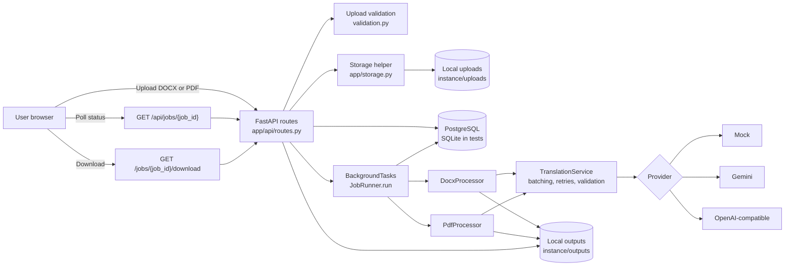

# TranslateDocs

TranslateDocs is a Python and FastAPI application for translating DOCX and PDF export documents while preserving as much readable structure as practical. It is intended for exporters, small trade teams, and evaluation users who need a simple upload-to-download translation workflow rather than a full document-management system.

The application supports a deterministic mock provider for development and a provider interface for Gemini and OpenAI-compatible endpoints. The current default is mock mode; it does not produce real translations.

> **Project status:** Early-stage evaluation project. The mock workflow is covered by automated tests. PostgreSQL runtime integration and live AI provider calls are **not verified**. The application is **not ready for public deployment** because authentication, rate limiting, output retention, and other abuse controls are not implemented.

## Features

- Upload DOCX and PDF documents through a browser form.
- Select a source language or auto-detect, and choose a target language.
- Validate file extension, size, structure, and password protection; reject scanned PDFs without a text layer during processing.
- Process documents through FastAPI background tasks.
- Poll job status and download completed output from the same job page.
- Translate DOCX paragraphs, tables, headers, and footers with approximate run-formatting preservation.
- Rebuild PDFs as readable text PDFs while preserving page sizes where practical.
- Switch between a deterministic mock provider, Gemini, and OpenAI-compatible endpoints.
- Batch translation requests with bounded retries and response validation.
- Generate synthetic DOCX and PDF samples for testing and demos.
- Run automated tests with isolated temporary SQLite databases.
- Enforce Alembic schema readiness at application startup.

## Technology stack

| Layer | Technology |
|---|---|
| Language | Python. The recorded local test run used Python 3.13.5; other versions were not verified. |
| Web application | FastAPI, Starlette, Jinja2, Uvicorn |
| Configuration | Pydantic Settings and `.env` |
| Database | SQLAlchemy 2.x, Alembic, PostgreSQL through `psycopg` |
| Test database | SQLite in isolated temporary directories |
| DOCX processing | `python-docx` |
| PDF processing | PyMuPDF (`pymupdf` / `fitz`) |
| AI providers | Mock, Google Gemini through `google-genai`, OpenAI-compatible HTTP endpoints through `httpx` |
| Testing | `pytest` and FastAPI `TestClient` |
| Frontend | Server-rendered HTML, CSS, and vanilla JavaScript polling |

PostgreSQL is the intended application database. SQLite is used by the test suite and can be used for local smoke testing, but SQLite test results do not prove PostgreSQL compatibility.

## Architecture



A more detailed explanation is available in [docs/architecture.md](docs/architecture.md).

## Repository layout

```text
app/
  api/routes.py                 HTTP routes and upload handling
  config.py                     Environment-backed settings
  database.py                   SQLAlchemy engine, sessions, schema gate
  models.py                     Job model and status values
  schemas.py                    API response models
  storage.py                    Local upload/output storage
  languages.py                  Supported languages and RTL set
  errors.py                     Safe application error types
  services/jobs.py              Background job execution
  services/documents/           DOCX, PDF, validation, and font logic
  services/translation/         Provider abstraction and implementations
  templates/                    Jinja2 pages
  static/                       CSS
alembic/
  versions/0001_create_jobs.py  Initial jobs table migration
tests/                          Pytest suite
scripts/make_samples.py         Synthetic sample generator
samples/                        Generated synthetic DOCX and PDF samples
docs/                           Architecture documentation
screenshots/                    Reserved; currently empty
```

## Prerequisites

- Python and `pip`.
- A PostgreSQL database for the intended application configuration.
- No API key is required for mock mode.
- A free or local OpenAI-compatible endpoint can be used instead of Gemini if configured.
- No dependency installation or database migration is performed automatically by the application.

## Installation

From the repository root on Windows PowerShell:

```powershell
python -m venv .venv
.\.venv\Scripts\Activate.ps1
python -m pip install -r requirements.txt
```

If PowerShell activation is restricted, call the virtual-environment interpreter directly:

```powershell
.\.venv\Scripts\python.exe -m pip install -r requirements.txt
```

On macOS or Linux:

```bash
python3 -m venv .venv
source .venv/bin/activate
python -m pip install -r requirements.txt
```

## Configuration

Create a local environment file from the example and edit it locally:

```powershell
Copy-Item .env.example .env
```

On macOS or Linux:

```bash
cp .env.example .env
```

Never commit `.env` or real credentials. The repository ignores `.env` files.

Important settings from `.env.example`:

| Variable | Purpose | Notes |
|---|---|---|
| `APP_NAME` | Display name | Defaults to `TranslateDocs`. |
| `APP_ENV` | Intended environment label | Declared in settings; not used by application behavior. |
| `APP_DEBUG` | Intended debug flag | Declared in settings; not used by application behavior. |
| `HOST` | Intended bind host | Not consumed by the app; pass the host to Uvicorn. |
| `PORT` | Intended bind port | Not consumed by the app; pass the port to Uvicorn. |
| `DATABASE_URL` | SQLAlchemy database URL | Use PostgreSQL for the intended configuration. |
| `DATABASE_ECHO` | SQLAlchemy echo logging | Use only for local debugging. |
| `STORAGE_ROOT` | Upload/output root | Defaults to `instance`. Relative paths resolve inside the project. |
| `MAX_UPLOAD_MB` | Maximum upload size | Defaults to `10`; validated between 1 and 100. |
| `AI_PROVIDER` | Provider selection | `mock`, `gemini`, or `openai_compatible`. |
| `GEMINI_API_KEY` | Gemini credential | Leave blank for mock mode; never commit it. |
| `GEMINI_MODEL` | Gemini model name | Defaults to `gemini-2.5-flash`. |
| `OPENAI_COMPAT_API_KEY` | Optional endpoint credential | Use only if the endpoint requires it. |
| `OPENAI_COMPAT_BASE_URL` | OpenAI-compatible base URL | Required for `openai_compatible`. |
| `OPENAI_COMPAT_MODEL` | OpenAI-compatible model name | Required for `openai_compatible`. |
| `AI_TIMEOUT_SECONDS` | Provider request timeout | Defaults to `60`. |
| `AI_MAX_RETRIES` | Retry count for transient/rate-limit errors | Defaults to `2`. |
| `AI_BATCH_SIZE` | Segments per provider request | Defaults to `20`. |
| `MAX_DOCUMENT_CHARS` | Maximum source characters per document | Defaults to `400000`. |
| `PDF_FONT_PATH` | Optional Unicode TrueType font | Used when rebuilding PDF output. |

The provider factory also accepts the aliases `openai`, `groq`, `openrouter`, and `ollama`, although `.env.example` documents only `openai_compatible`.

## Database setup

PostgreSQL is the intended database. Create a PostgreSQL database and user through your local PostgreSQL installation, hosting provider, or managed database console, then set `DATABASE_URL` in `.env` to a URL using the `postgresql+psycopg://` driver.

Run the migration from the repository root with the virtual environment active:

```powershell
alembic upgrade head
```

You can inspect the current revision with:

```powershell
alembic current
```

Important behavior:

- The application does **not** create tables automatically.
- The application does **not** stamp or upgrade databases automatically.
- Startup calls the schema-readiness check and refuses to start if the database is missing, unversioned, at the wrong revision, or missing the `jobs` table.
- The initial migration is `0001_create_jobs.py`.
- If a local database already contains a `jobs` table without `alembic_version`, do not stamp it blindly. Back it up and reconcile it manually.
- The test suite uses isolated temporary SQLite databases and does not require PostgreSQL.

PostgreSQL runtime migration has **not been verified** in this repository. The migration is portable by inspection, but there is no recorded PostgreSQL execution, CI job, or deployment evidence.

## Running the application

With the virtual environment active, from the repository root:

```powershell
uvicorn app.main:app --reload --host 127.0.0.1 --port 8000
```

Or call the interpreter directly:

```powershell
.\.venv\Scripts\python.exe -m uvicorn app.main:app --reload --host 127.0.0.1 --port 8000
```

Open `http://127.0.0.1:8000`.

The `HOST` and `PORT` values in `.env` are informational at present; pass the bind address to Uvicorn explicitly.

## API endpoints

| Method | Path | Purpose |
|---|---|---|
| `GET` | `/` | Upload page. |
| `POST` | `/translate` | Accept a multipart DOCX/PDF upload and create a job. |
| `GET` | `/jobs/{job_id}` | Job progress page. |
| `GET` | `/api/jobs/{job_id}` | Job status as JSON. |
| `GET` | `/jobs/{job_id}/download` | Download a completed translated file. |
| `GET` | `/health` | Basic database and provider health response. |

`/health` checks database connectivity and reports the active provider. It does not perform a full schema audit.

## Running tests

Run the complete test suite with:

```powershell
.\.venv\Scripts\python.exe -m pytest -o addopts="" -p no:cacheprovider --tb=short
```

What the tests cover:

- FastAPI health and page rendering.
- DOCX and PDF mock-mode upload-to-download flows.
- Upload validation, language validation, and filename sanitization.
- Provider retries, malformed responses, batching, and parsing.
- OpenAI-compatible HTTP behavior with a fake client.
- Gemini error classification.
- Alembic migration success and schema startup failures.

Test limitations:

- Tests use SQLite, not PostgreSQL.
- Tests use the mock provider; live Gemini and OpenAI-compatible calls are not tested.
- There is no browser-based end-to-end test.
- There is no load, concurrency, restart-recovery, zip-bomb, or output-retention test.

The last recorded local run in this workspace reported **64 passed, 1 warning** (a Starlette/httpx deprecation warning). This count may change as tests are added.

## Synthetic sample documents

Generate fresh synthetic samples:

```powershell
.\.venv\Scripts\python.exe scripts\make_samples.py
```

The script writes:

- `samples/sample_export_invoice.docx`
- `samples/sample_packing_list.pdf`

All sample content is invented and safe for evaluation. Do not add client, personal, or confidential documents to the repository.

## Mock provider versus real providers

### Mock provider

Default configuration:

```dotenv
AI_PROVIDER=mock
```

The mock provider does not call a network service. It prefixes text with the target language code, for example `[es] Commercial Invoice`. The UI displays a development-mode warning while mock mode is active. Mock output is not a real translation and should not be presented as one.

### Gemini

Configure:

```dotenv
AI_PROVIDER=gemini
GEMINI_API_KEY=your-key-here
GEMINI_MODEL=gemini-2.5-flash
```

Do not commit the key. Gemini integration is implemented, but a live Gemini call has **not been verified** by repository evidence.

### OpenAI-compatible endpoints

Configure:

```dotenv
AI_PROVIDER=openai_compatible
OPENAI_COMPAT_BASE_URL=https://your-endpoint.example/v1
OPENAI_COMPAT_MODEL=your-model
OPENAI_COMPAT_API_KEY=optional-key
```

The implementation posts to `{OPENAI_COMPAT_BASE_URL}/chat/completions`. This can be used with Groq, OpenRouter, a local Ollama server, or another compatible endpoint. The endpoint may be free or paid; verify its terms and availability yourself.

No live OpenAI-compatible provider call has been verified by repository evidence. Automated tests use a fake HTTP client.

## DOCX formatting limitations

The DOCX processor:

- Preserves document structure, headings, paragraphs, tables, and headers/footers where supported by `python-docx`.
- Translates body, table, header, and footer paragraph text.
- Attempts to preserve bold, italic, colour, and font formatting by redistributing translated text across the original runs.
- Leaves images, charts, text boxes, footnotes, comments, and tracked changes in the file, but does not translate their text.
- May shift complex layouts and line breaks inside paragraphs.
- May not translate every Word structure, including some hyperlink or content-control text.

Formatting preservation is approximate, not pixel-perfect. Review translated documents before sharing.

## PDF formatting limitations

The PDF processor:

- Extracts text blocks and rebuilds a text-based PDF.
- Preserves page sizes and basic page flow where practical.
- Creates continuation pages when translated content does not fit.
- Does **not** preserve images, vector graphics, tables, multi-column layouts, exact fonts, or original text positions.
- Does **not** support scanned PDFs without a text layer because OCR is not included.
- Attempts right alignment for Arabic, Urdu, Persian, and Hebrew, but RTL shaping and visual output have not been verified.
- Uses a configured or auto-detected Unicode font for non-Latin text; missing font coverage can cause translation failure.

If preserving the original PDF layout is required, this application does not currently meet that requirement.

## Security, privacy, and third-party AI processing

**Do not deploy this application publicly in its current state.**

Current limitations:

- No authentication or user accounts.
- No authorization or ownership checks. Anyone who obtains a job URL can view status and download output.
- No rate limiting, quota, or global concurrency control.
- No CSRF protection.
- Background jobs are in-process and are lost or left incomplete if the process restarts.
- No output retention or expiry policy.
- No automatic cleanup of an upload orphaned by a database failure before job creation.
- No decompression or zip-bomb limit for DOCX archives.
- No malware or document-content scanning.
- No OCR.
- `HOST`/`PORT` do not configure TLS or a reverse proxy.

Privacy behavior:

- The database stores job metadata, not document contents.
- Source uploads are deleted after processing completes or fails. An upload saved just before a database failure can remain in `instance/uploads`.
- Translated outputs remain in `instance/outputs` until manually removed.
- When a real provider is configured, extracted document text is sent to that third-party provider. Do not process confidential documents without reviewing the provider's terms, data handling, and retention policy.
- Job IDs are effectively access tokens; treat job URLs as sensitive.

Use synthetic samples or non-sensitive documents for evaluation.

## Current project status and known gaps

- Latest committed code baseline at documentation time: `6e028ffdc2372e3e287dc32568821c15edeb2349`.
- The DOCX and PDF mock workflows are implemented and covered by automated tests.
- PostgreSQL runtime integration is **not verified**.
- Live Gemini and OpenAI-compatible provider calls are **not verified**.
- This README and `docs/architecture.md` are new documentation additions.
- No screenshots or demo video are currently available.
- No deployment URL, deployment configuration, or public demo exists.
- No CI workflow or dependency lockfile exists.
- No authentication, rate limiting, or output retention controls exist.
- No real PostgreSQL or live provider evidence exists in the repository.
- No screenshots or demo evidence should be inferred from the UI.

## Demo video

**Not yet available.** A demo video has not been recorded or published. Do not treat this section as a link to an existing demo.

## Screenshots

**Not yet available.** The `screenshots/` directory is currently empty.

## Documentation

- [Architecture](docs/architecture.md)
- [Environment example](.env.example)

## License

No license file is currently included in this repository.
