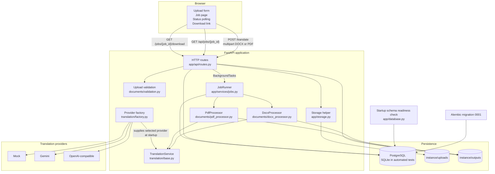

# Architecture

This document describes the current TranslateDocs implementation. PostgreSQL migration `0001`, the startup schema gate, local health, and a synthetic DOCX/PDF mock workflow were verified against Neon on 2026-11-02. Live Gemini and OpenAI-compatible provider calls remain unverified.

## System overview

TranslateDocs is a server-rendered FastAPI application with an in-process background job runner, local file storage, and a provider abstraction for translation.

## Main components

### Application factory and lifecycle

`app/main.py:create_app` builds the FastAPI application, storage helper, database object, translation provider, translation service, and `JobRunner`.

The lifespan handler calls `Database.require_current_schema()` before accepting requests. Startup fails if the database is unreachable, unversioned, missing the `jobs` table, or not at the current Alembic head. The application does not create tables, stamp revisions, or migrate automatically.

### HTTP routes

`app/api/routes.py` provides:

- `GET /` — upload page.
- `POST /translate` — validates form fields and the upload, saves the source file, creates a `jobs` row, schedules `JobRunner.run`, and redirects to the job page.
- `GET /jobs/{job_id}` — server-rendered job page.
- `GET /api/jobs/{job_id}` — JSON status used by page polling.
- `GET /jobs/{job_id}/download` — completed output download.
- `GET /health` — basic database connectivity and active-provider response.

There is no authentication or authorization layer. Job identifiers are therefore access tokens in practice.

### Upload validation and storage

`app/services/documents/validation.py` checks:

- Filename sanitization and path traversal prevention.
- Allowed extensions `.docx` and `.pdf`.
- Non-empty and maximum upload size.
- DOCX ZIP structure and required document parts.
- PDF signature, readability, page count, and password protection.

`app/storage.py` stores uploads under `instance/uploads` and generated outputs under `instance/outputs` using UUID-based names. Stored file references are checked so they cannot escape their base directory.

### Job execution

`app/services/jobs.py:JobRunner.run` is scheduled through FastAPI `BackgroundTasks`, not a durable queue.

On a normal run it:

1. Loads the queued job.
2. Marks it `processing` and records `started_at`.
3. Resolves the input file.
4. Selects `DocxProcessor` or `PdfProcessor`.
5. Runs translation and output generation.
6. Marks the job `completed` with output metadata, stats, and warnings.
7. Deletes the source upload in `finally`.
8. Deletes a partial output if processing failed.

Failures are persisted as `failed` with a safe user-facing error message. Unexpected exceptions are logged and exposed only as a generic processing error.

Because the runner is in-process, a restart can leave jobs stuck in `queued` or `processing`. There is no startup recovery, stale-job reconciliation, or global concurrency limit.

### DOCX processing

`DocxProcessor.process` uses `python-docx`.

It collects translatable paragraphs from the document body, tables, nested tables, headers, and footers. Paragraph text is translated as one segment per paragraph, then redistributed across the original runs in proportion to source text length. This preserves headings, tables, headers/footers, and approximate run formatting such as bold, italic, colour, and font.

It does not translate text inside images, charts, text boxes, footnotes, comments, or tracked changes. Complex layouts and line breaks may shift.

### PDF processing

`PdfProcessor.process` uses PyMuPDF.

It extracts text blocks with `page.get_text("dict", sort=True)`, translates block text, and rebuilds a new text-based PDF. It preserves page sizes and basic page flow where practical, adding continuation pages when translated content does not fit.

It does not preserve images, vector graphics, tables, multi-column layouts, exact fonts, or original text positions. Scanned PDFs without a text layer are rejected because OCR is not implemented. RTL targets use right alignment, but shaping and visual output have not been verified.

### Provider abstraction

`app/services/translation/base.py` defines `TranslationProvider` and `TranslationService`.

`TranslationService` adds:

- Batch sizing.
- Long-segment splitting.
- Document character limit.
- Bounded retries for rate-limit and transient errors.
- Response length and type validation.

`app/services/translation/factory.py` selects:

- `MockTranslationProvider` — deterministic, no network, default.
- `GeminiTranslationProvider` — Google GenAI SDK.
- `OpenAICompatibleTranslationProvider` — HTTP `/chat/completions` client.

Mock mode is clearly identified in the UI and is the only provider path covered by end-to-end tests. Gemini error classification is unit-tested. OpenAI-compatible request handling is tested with a fake HTTP client. No live provider call is verified in the repository.

### Database and schema gate

The `Job` model is defined in `app/models.py` and stored in the `jobs` table.

`alembic/versions/0001_create_jobs.py` creates the table and its `status` and `created_at` indexes.

`app/database.py:Database.require_current_schema` performs a read-only startup check:

- Ordinary missing SQLite files are rejected before connecting.
- The database must be reachable.
- `alembic_version` must exist and contain a valid revision.
- The revision must exactly match the current Alembic head.
- The `jobs` table must exist.

The check does not validate every column or index at startup. PostgreSQL execution of migration `0001`, the schema gate, and application health was verified against Neon; the limitation remains that the automated suite uses SQLite rather than PostgreSQL.

### PostgreSQL verification

On 2026-11-02, the configured Neon direct endpoint was verified with the mock provider:

- `alembic upgrade head` applied revision `0001`; `alembic current` reported `0001 (head)`.
- The `jobs` and `alembic_version` tables and both `jobs` indexes were present.
- `Database.require_current_schema()` passed.
- The local application started and `/health` returned database `ok` and provider `mock`.
- One synthetic DOCX and one synthetic PDF completed upload-to-download, including valid downloadable outputs.
- The exact smoke-test job rows and generated output files were removed afterward.

This was a manual, direct-endpoint smoke test. It is not an automated PostgreSQL CI test, and no production database, backup, or deployment configuration is claimed.

## Upload-to-download workflow

1. The user opens `/` and submits a DOCX or PDF with source and target languages.
2. `create_translation` validates the language fields and reads the upload with a size limit.
3. `validate_upload` checks extension, size, structure, and PDF/DOCX integrity.
4. `Storage.save_upload` writes a UUID-named source file under `instance/uploads`.
5. A queued `Job` row is committed to the database.
6. `JobRunner.run` is scheduled as an in-process background task after the response.
7. The browser is redirected to `/jobs/{job_id}`, which polls `/api/jobs/{job_id}`.
8. The runner selects the document processor and calls `TranslationService`.
9. The processor writes a translated file under `instance/outputs`.
10. The job is marked completed with output filename, segment/character counts, and warnings.
11. The source upload is deleted on normal completion or failure.
12. The browser shows the download link once the job is completed.
13. `download` verifies the job state and output path, then returns the file with the original file type.

## Failure handling

- Validation failures return safe HTML error messages.
- Unsupported, empty, corrupted, oversized, or password-protected files are rejected.
- Scanned PDFs fail with an OCR explanation.
- Provider configuration errors, rate limits, transient failures, and malformed responses are translated into safe application errors.
- Unexpected processing exceptions are logged and exposed generically.
- Within a job run, input files are deleted in `finally`; partial outputs are deleted when the job did not succeed.
- An upload orphaned by a database failure before job creation is not cleaned up automatically.
- The startup schema gate fails fast instead of creating or migrating schema.

## Deployment boundary

There is no deployment configuration or public deployment evidence in the repository. Public deployment remains pending and is not recommended in the current state. See [deployment-assessment.md](deployment-assessment.md) for the zero-cost assessment and the recorded-demo fallback.

Do not expose the application publicly without first adding:

- Authentication and authorization.
- Rate limiting and concurrency controls.
- Output retention and cleanup.
- Upload decompression and resource limits.
- A durable job queue or restart recovery strategy.
- A reverse proxy with TLS.
- A review of third-party AI data handling and privacy requirements.

## Verification status

| Area | Status |
|---|---|
| Mock DOCX upload-to-download workflow | Verified by automated tests |
| Mock PDF upload-to-download workflow | Verified by automated tests |
| Mock/provider abstraction unit behavior | Verified by automated tests |
| SQLite migration and schema gate | Verified by automated tests |
| PostgreSQL connection, revision `0001`, schema gate, startup health | Verified manually on Neon, 2026-11-02 |
| PostgreSQL synthetic DOCX/PDF mock workflow | Verified manually on Neon; smoke rows and files cleaned up |
| Automated PostgreSQL test job | Not present; automated tests use SQLite |
| Live Gemini call | Not verified |
| Live OpenAI-compatible call | Not verified |
| Browser screenshots | Captured from the local app on 2026-11-02; interactive flow is not automated |
| Demo video | Not recorded; script available in `docs/demo-script.md` |
| Public deployment | Not available and not recommended in current state |

See the [README](../README.md) for setup, configuration, testing, and security notes.
